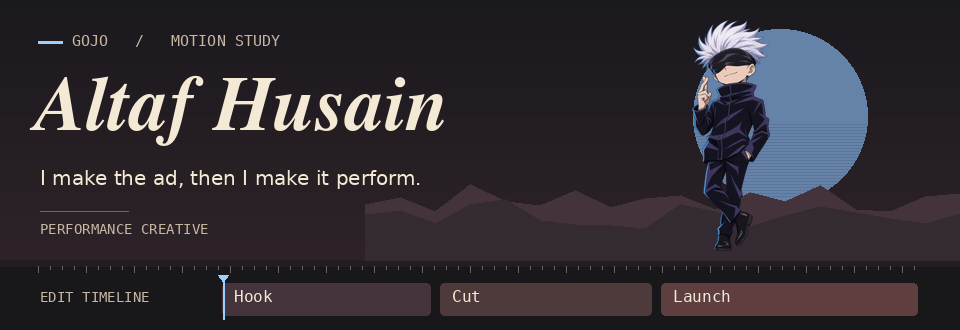
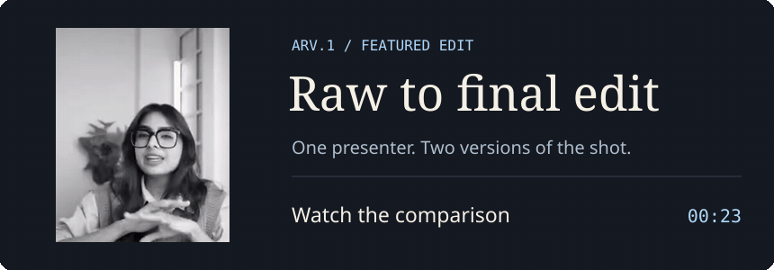
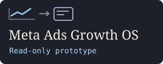
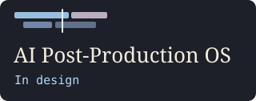

<a href="https://altafhusain.netlify.app/">
  <picture>
    <source media="(max-width: 600px) and (prefers-reduced-motion: reduce)" srcset="assets/gojo-mobile.webp">
    <source media="(prefers-reduced-motion: reduce)" srcset="assets/gojo-poster.webp">
    <source media="(max-width: 600px)" srcset="assets/gojo-mobile.gif">
    
  </picture>
</a>

<!-- Optional animation: add a slim, self-hosted header visual here. -->

# Altaf Husain · Performance Creative Specialist

I’m a Delhi-based editor and performance marketer. I take an ad from script to shoot to Meta campaign. When people leave early, I revisit the opening shot. When an ad brings in enquiries, I check what happens after the first reply.

[Featured edit](#featured-edit) · [Projects](#projects) · [Contribution timeline](#contribution-timeline) · [Connect](#connect)

## Featured edit

<a href="https://drive.google.com/file/d/1lOWCoYUu7LxhB78B4cBXJxBS0PpAn3Bu/view">
  <picture>
    <source media="(prefers-reduced-motion: reduce)" srcset="assets/reel-rest.webp">
    
  </picture>
</a>

[Watch ARV.1](https://drive.google.com/file/d/1lOWCoYUu7LxhB78B4cBXJxBS0PpAn3Bu/view) · [Explore my edited and AI-generated videos](https://altafhusain.netlify.app/#video-editing)

<strong>Inside the edit</strong>

Watch the presenter’s face as the wipe crosses the frame, then look at the warm light behind her. Seeing the same shot twice makes the colour grade easier to judge. The full 23-second reel shows both versions side by side.

<strong>How I choose the next cut for a campaign</strong>

| Signal | Next test |
| --- | --- |
| Viewers leave in the opening seconds | Bring the result into the first shot and compare opening retention. |
| Viewers stay but rarely click | Keep the edit and test a more specific offer or call to action. |
| Clicks produce poor-fit enquiries | Tighten the promise in the ad and review the next batch with sales. |

## Projects

| Project | What I’m working on |
| --- | --- |
|  | I’m testing whether each salesperson sees their own assigned leads and can find the next follow-up in Google Sheets. [See the walkthrough](#crm-walkthrough) |
|  | I’ve connected read-only campaign history. I’m designing the review that turns a past campaign into a creative test brief, with human approval for publishing and budget changes. |
|  | I’m designing reusable captions and kinetic type that an editor can adjust in Premiere Pro and After Effects. |

<!-- Optional animation: add a short CRM walkthrough here using fictional lead data. -->

## Tools & Stack

| Workflow | Tools and practice |
| --- | --- |
| **Create** | Premiere Pro and DaVinci Resolve for the cut and grade. After Effects for motion type. Photoshop for thumbnails. |
| **Test** | Meta Ads and Google Ads for comparing hooks, offers and the quality of enquiries. |
| **Explore** | ChatGPT and Claude for briefs. Runway, Higgsfield and Veo for trying another opening before a reshoot. |
| **Automate** | Google Sheets and Apps Script for lead assignment, follow-up and reporting. |

## CRM walkthrough

A fictional buyer asks for a catalogue. A rep takes ownership and schedules a call for 11:00 the next day.

<picture>
  <source media="(max-width: 600px)" srcset="assets/crm-handoff-mobile.svg">
  
</picture>

## Creator background

I grew my YouTube channel to **800K+ subscribers and 100M+ views** and earned a Silver Play Button. I wrote the scripts, designed the thumbnails and edited the videos. One habit I carried into ads is checking the thumbnail against the first shot. If they promise different things, that’s where I start the next edit. [More about my experience](https://altafhusain.netlify.app/#experience)

I study commerce at IGNOU and 2D animation at Arena Animation. I’m also developing VAREN, my growth marketing agency project.

## Contribution timeline

<a href="https://github.com/pvaour-code#js-contribution-activity-description">
  <picture>
    <source media="(max-width: 600px)" srcset="assets/activity-mobile.svg">
    
  </picture>
</a>

[Open the live calendar](https://github.com/pvaour-code#js-contribution-activity-description) · [Browse profile commits](https://github.com/pvaour-code/pvaour-code/commits/main/)

<strong>What I shipped in November</strong>

- [Added the raw-to-edit comparison and CRM walkthrough](https://github.com/pvaour-code/pvaour-code/commit/bae9f65b17c406455c59f40273ed084e926f2b09).
- [Introduced the Gojo editing timeline and project covers](https://github.com/pvaour-code/pvaour-code/commit/c49e03da5263d3e9529d67c48710d6dc78ce54b4).

## Connect

Working on an ad? Send me the cut, the audience and the one thing you want viewers to do next.

[Watch my work](https://altafhusain.netlify.app/#video-editing) · [Email me](mailto:pvaour@gmail.com) · [Download my CV](https://altafhusain.netlify.app/cv/altaf-husain-cv.pdf)

<!-- Add verified social links here when ready.
- [LinkedIn](YOUR_LINKEDIN_URL)
- [Instagram / Portfolio](YOUR_INSTAGRAM_OR_PORTFOLIO_URL)
-->
