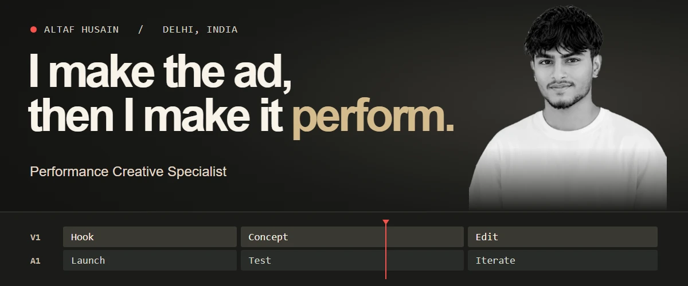
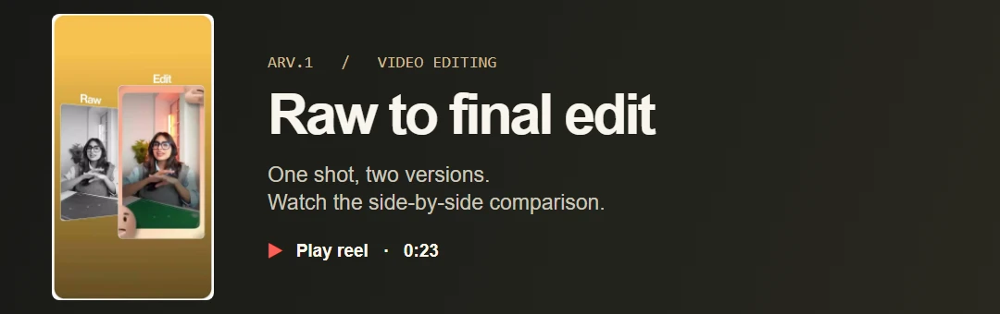

<!-- Optional animation: add a slim, self-hosted header visual here. -->

# Altaf Husain · Performance Creative Specialist

I write, shoot and edit ads, then run them on Meta. I use retention and click-through data to decide what to change in the next cut. AI video helps me test a new visual or opening without reshooting the whole ad.

[Portfolio](https://altafhusain.netlify.app/) · [Video editing archive](https://altafhusain.netlify.app/#video-editing) · [CV](https://altafhusain.netlify.app/cv/altaf-husain-cv.pdf)

## Featured edit

[Watch ARV.1](https://drive.google.com/file/d/1lOWCoYUu7LxhB78B4cBXJxBS0PpAn3Bu/view) · [Explore my edited and AI-generated videos](https://altafhusain.netlify.app/#video-editing)

## Where I learned to edit for attention

I built my own YouTube channel to **800K+ subscribers and 100M+ views** and earned a Silver Play Button. I handled the scripts, thumbnails and edits myself. That experience still shapes how I test ads: if viewers click but leave early, the first thing I revisit is whether the opening shot delivers what the thumbnail promised. [Creator background](https://altafhusain.netlify.app/#experience)

## What I’m building

| Project | Current work |
| --- | --- |
| **B2B Lead CRM** | Testing salesperson-specific lead views in a Google Sheets and Apps Script CRM for assignments and follow-ups. |
| **Meta Ads Growth OS** | Read-only account access is connected. I’m designing a workflow that turns campaign history into creative tests, with human approval for publishing and budget changes. |
| **AI Video Post-Production OS** | Designing an editing workflow for reusable captions, kinetic type and motion graphics across Premiere Pro and After Effects. |

<!-- Optional animation: add a short CRM walkthrough here using fictional lead data. -->

## Tools & Stack

| Discipline | Tools and practice |
| --- | --- |
| Performance marketing | Meta Ads, Google Ads, SEO, creative testing and campaign reporting |
| Editing & motion | Adobe Premiere Pro, After Effects, DaVinci Resolve and Photoshop |
| AI video & workflows | Runway, Higgsfield and Veo for visual variations. ChatGPT and Claude for briefs and workflow design. |
| Automation | Google Sheets and Apps Script for lead routing, follow-up and reporting |

I’m studying commerce at IGNOU and 2D animation at Arena Animation. I’m also developing VAREN, my growth marketing agency project.

## Connect

[Portfolio](https://altafhusain.netlify.app/) · [Get in touch](https://altafhusain.netlify.app/#contact)

<!-- Replace each placeholder below, then move its line outside this comment.
- [LinkedIn](YOUR_LINKEDIN_URL)
- [Instagram / Portfolio](YOUR_INSTAGRAM_OR_PORTFOLIO_URL)
- [Business email](mailto:YOUR_BUSINESS_EMAIL)
-->
