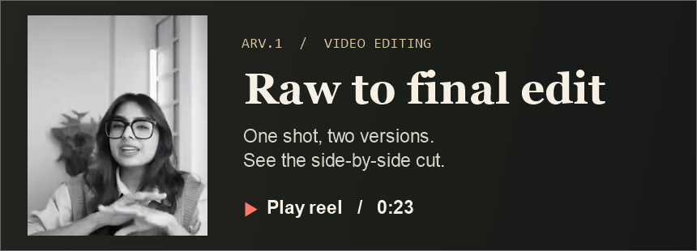
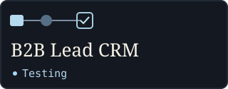
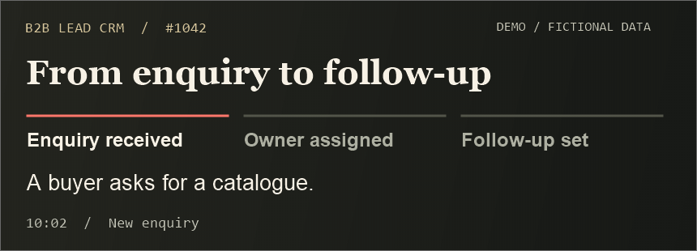
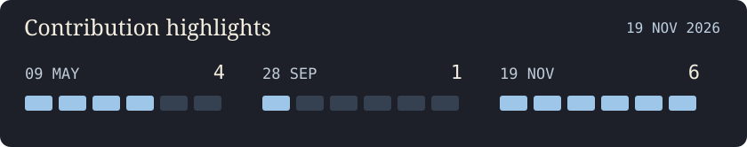

<a href="https://altafhusain.netlify.app/">
  <picture>
    <source media="(prefers-reduced-motion: reduce)" srcset="assets/gojo-poster.webp">
    
  </picture>
</a>

<!-- Optional animation: add a slim, self-hosted header visual here. -->

# Altaf Husain · Performance Creative Specialist

I’m based in Delhi. I write, shoot and edit ads, then run them on Meta. Watching where people drop off helps me choose the next cut. Tracking what happens after an enquiry helps me judge whether the ad reached the right buyer.

[Watch my work](https://altafhusain.netlify.app/#video-editing) · [Projects](#projects) · [Connect](#connect)

## Featured edit

<a href="https://drive.google.com/file/d/1lOWCoYUu7LxhB78B4cBXJxBS0PpAn3Bu/view">
  <picture>
    <source media="(prefers-reduced-motion: reduce)" srcset="assets/raw-to-edit.webp">
    
  </picture>
</a>

[Watch ARV.1](https://drive.google.com/file/d/1lOWCoYUu7LxhB78B4cBXJxBS0PpAn3Bu/view) · [Explore my edited and AI-generated videos](https://altafhusain.netlify.app/#video-editing)

<strong>Inside the edit</strong>

ARV.1 puts two versions of the same presenter side by side. Follow her face in the monochrome frame, then look at the warm light behind her in the colour edit. With the subject held constant, it’s easier to see what the grade contributes.

<strong>How I choose the next cut for a campaign</strong>

| Signal | Next test |
| --- | --- |
| Viewers leave in the opening seconds | Bring the result into the first shot and compare opening retention. |
| Viewers stay but rarely click | Keep the edit and test a more specific offer or call to action. |
| Clicks produce poor-fit enquiries | Tighten the promise in the ad and review the next batch with sales. |

## Creator background

I grew my YouTube channel to **800K+ subscribers and 100M+ views** and earned a Silver Play Button. I wrote the scripts, designed the thumbnails and edited the videos. One habit I carried into ads is checking the thumbnail against the first shot. If they promise different things, that’s where I start the next edit. [More about my experience](https://altafhusain.netlify.app/#experience)

## Projects

| Project | What I’m working on |
| --- | --- |
|  | I’m testing whether each salesperson sees their own assigned leads and can find the next follow-up in Google Sheets. [See the walkthrough](#crm-walkthrough) |
|  | I’ve connected read-only campaign history. I’m designing the review that turns a past campaign into a creative test brief, with human approval for publishing and budget changes. |
|  | I’m designing reusable captions and kinetic type that an editor can adjust in Premiere Pro and After Effects. |

<!-- Optional animation: add a short CRM walkthrough here using fictional lead data. -->

## Tools & Stack

| Workflow | Tools | What I use them for |
| --- | --- | --- |
| Create | Premiere Pro, After Effects, DaVinci Resolve, Photoshop | Cut footage, grade a shot, animate type and design thumbnails. |
| Test | Meta Ads, Google Ads | Compare hooks and offers, review click-through and lead quality. |
| Explore | Runway, Higgsfield, Veo, ChatGPT, Claude | Draft briefs and try alternative openings before a reshoot. |
| Automate | Google Sheets, Apps Script | Assign enquiries, track follow-ups and prepare reports. |

### CRM walkthrough

A fictional buyer asks for a catalogue. A rep takes ownership and schedules a call for 11:00 the next day.

<picture>
  <source media="(prefers-reduced-motion: reduce)" srcset="assets/crm-demo.webp">
  
</picture>

I study commerce at IGNOU and 2D animation at Arena Animation. I’m also developing VAREN, my growth marketing agency project.

## Contribution timeline

[View my live GitHub activity](https://github.com/pvaour-code#js-contribution-activity-description)

## Connect

For performance creative, video production or a lead automation project, send me the brief and the outcome you want to measure.

[Watch my work](https://altafhusain.netlify.app/#video-editing) · [Email me](mailto:pvaour@gmail.com) · [Download my CV](https://altafhusain.netlify.app/cv/altaf-husain-cv.pdf)

<!-- Add verified social links here when ready.
- [LinkedIn](YOUR_LINKEDIN_URL)
- [Instagram / Portfolio](YOUR_INSTAGRAM_OR_PORTFOLIO_URL)
-->
